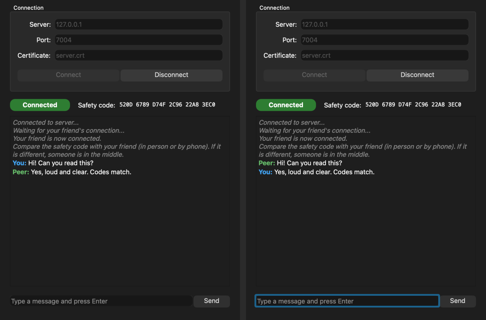
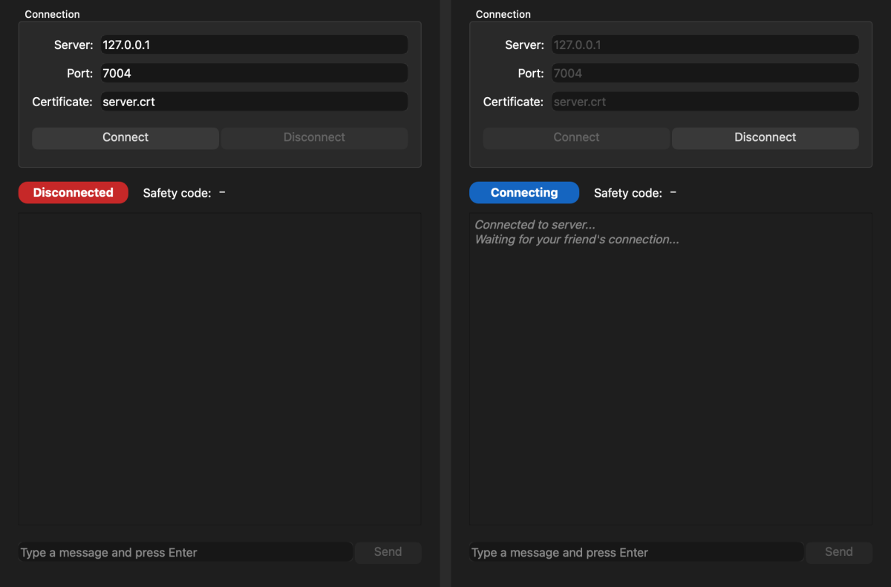

# Secure Chat Client (end-to-end encryption)

The client for a two-person secure chat. Messages are encrypted on your computer and only decrypted on your friend's, so the server in the middle only ever forwards ciphertext. A safety code lets the two of you check that nobody, not even the server, swapped the keys.



*Two clients connected over TLS. Both show the same safety code, so the keys were not swapped.*

## Server Application

The clients talk through a small relay server. You can find it, with its setup steps, here:

https://github.com/Arad-Afzali/secure-messaging-server-side

## Features

- **End-to-end encryption.** Messages are encrypted with AES-256-GCM. The keys come from an X25519 key exchange, run through HKDF-SHA256, with a separate key for each direction.
- **New keys every session.** Each chat uses a fresh X25519 key pair, so a key leaked later cannot decrypt old chats (forward secrecy).
- **Safety code.** Each client has a long-term Ed25519 identity key (`identity_key.pem`) and signs its session key with it. Both users see the same safety code; if they compare it (in person or by phone) and it matches, the server or anyone else cannot have swapped the keys.
- **Replay and tamper protection.** Every message carries a counter that is checked, and AES-GCM rejects any message changed on the way.
- **TLS to the server.** Give the client the server's certificate and the connection to the server is also wrapped in TLS, with the certificate and hostname checked.
- **Message framing.** Every message is sent with a 4-byte length first (`protocol.py`), so long messages and fast messages arrive whole.
- **PyQt5 GUI.** Connection status, the safety code, and colored chat. You can only type once the keys are exchanged.

### How it works

1. Both clients connect to the server and send their identity key, a new X25519 session key, and a signature over the session key.
2. The server passes each client's keys to the other. It never sees a private key.
3. Each client checks the signature, does X25519, and derives the two AES keys.
4. Both users compare the safety code shown in the app.
5. Messages are encrypted on one client and only decrypted on the other. The server only forwards them.

| File | What it does |
|---|---|
| `client.py` | Connection, key exchange and sending/receiving messages |
| `client_crypto.py` | Identity key, X25519, HKDF, AES-GCM, safety code |
| `client_gui.py` | The PyQt5 window |
| `protocol.py` | Length-prefixed messages over TCP |

## Requirements

- Python 3.8+
- PyQt5
- cryptography

## Installation

1. **Clone the repository**:

    ```bash
    git clone https://github.com/Arad-Afzali/secure-messaging-client-side.git
    cd secure-messaging-client-side
    ```

2. **Create a virtual environment and activate it** (Recommended):

    **On macOS and Linux:**
    ```bash
    python3 -m venv venv
    source venv/bin/activate
    ```

    **On Windows:**
    ```bash
    python -m venv venv
    venv\Scripts\activate
    ```

3. **Install the required packages**:

    ```bash
    pip install -r requirements.txt
    ```

4. **TLS (recommended)**: get `server.crt` from whoever runs the server (see `make_cert.sh` in the server repository) and put it next to `client.py`. It holds no secret.

## Usage

1. **Start the client application**:
    ```bash
    python3 client.py
    ```

2. **Enter the server address, the port and the certificate file, then click "Connect".** The status turns blue while you wait for your friend. Without a certificate the app still works, but the connection to the server is not TLS.

    

3. **When your friend connects, compare the safety code.** The status turns green and the code appears next to it. Read it out over a phone call or check it in person. If the codes differ, disconnect: someone is in the middle.

4. **Chat.** Type a message and press Enter.

## Contributing

Contributions are welcome! Please open an issue or submit a pull request.
